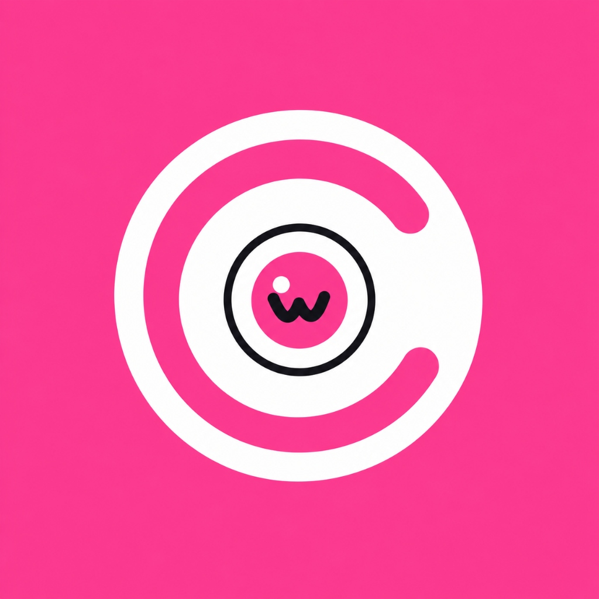

<p align="center">
  
</p>

<h1 align="center">Cuttle</h1>

<p align="center">
  <b>Right-click any file in Windows Explorer, pick the format you want, and get a converted copy instantly.</b><br>
  <i>100% Offline • Zero Uploads • Free & Open-Source (GPL-3.0) • No Account Required</i>
</p>

<p align="center">
  <a href="https://github.com/Ameya79/cuttle/blob/main/LICENSE"></a>
  
  
  
  
  <a href="docs/BENCHMARKS.md"></a>
  <a href="https://benchtoplabs.vercel.app/p/cuttle"></a>
</p>

<p align="center">
  <a href="https://benchtoplabs.vercel.app/p/cuttle">
    
  </a>
</p>

---

## 🌟 Highlights

- 🖱️ **Zero App to Open**: Seamlessly integrated into the native Windows File Explorer right-click context menu (including top-level Windows 11 menu via sparse package).
- 🔒 **Sacred Originals**: Your source files are never modified, renamed, moved, or deleted.
- 🛡️ **Never Overwrites**: If `sample.mp3` exists, Cuttle creates `sample (converted).mp3`, then `(2).mp3`, collision-free.
- ⚡ **Sub-20ms Startup**: Lightweight launcher communicates with a persistent background worker via native Windows Named Pipes.
- 📊 **Floating Progress Card**: A frameless dark UI card in the bottom-right corner displays live conversion progress and cancel buttons.
- 🔔 **Interactive Windows Notifications**: One-click **[Open File]** and **[Show in Folder]** action buttons right from the Windows toast banner.
- 🏷️ **Honest Quality Transparency**: Every conversion clearly indicates whether it is **Lossless**, **Lossy**, or **Best Effort** (see [`docs/quality.md`](docs/quality.md)).
- 🚀 **Empirical Benchmarks**: Measured conversion speeds and mathematical fidelity in [`docs/BENCHMARKS.md`](docs/BENCHMARKS.md).
- 💬 **Plain-English Feedback**: Never decipher cryptic error codes: get clear messages like *"The file is password-protected"* or *"Disk full"*.

---

## 🔄 Supported Conversions (Complete v1.0 Matrix)

| Category | Input Formats | Target Formats | Engine / Quality |
|:---|:---|:---|:---|
| 📄 **Documents** | `PDF` | `DOCX`, `PNG`, `JPG` | pdf2docx / PyMuPDF (Best Effort / Lossless) |
| 📄 **Documents** | `DOCX`, `PPTX`, `XLSX`, `ODT` | `PDF` | LibreOffice / soffice (Lossless) |
| 📝 **Markup** | `MD` (Markdown), `HTML`, `TXT` | `DOCX`, `HTML`, `MD`, `PDF` | Pandoc AST (Lossless) |
| 🖼️ **Images** | `PNG`, `JPG`, `WebP`, `BMP`, `TIFF`, `HEIC` | `PNG`, `JPG`, `WebP`, `BMP`, `TIFF`, `PDF` | Pillow / pillow-heif (Bit-Exact / >52 dB PSNR) |
| 🖼️ **Batch Images**| Multiple `PNG`, `JPG`, `WebP` | Merged Multi-Page `PDF` | Native PyMuPDF / Pillow (Lossless) |
| 📐 **CAD / Drawings** | `DWG` | `DXF`, `PDF` | LibreDWG / ODA Converter Add-on (Best Effort) |
| 🎬 **Video** | `MP4`, `MKV`, `MOV`, `AVI`, `WebM` | `MP4`, `WebM`, `GIF`, `MP3`, `WAV` | FFmpeg software encoder (Lossy / Lossless) |
| 🎵 **Audio** | `WAV`, `MP3` | `MP3`, `WAV` | FFmpeg (Lossless / Lossy) |

---

## 🏛️ System Architecture

```
[Windows File Explorer (Any Folder)]
   │  (Right-click file: "Cuttle ➔ Convert to MP3")
   ▼
[cuttlectl.exe]  (Sub-20ms ultra-fast launcher; zero console flash)
   │  (IPC over Windows Named Pipe \\.\pipe\cuttle-<user>)
   ▼
[cuttle-worker daemon]  (Background Qt engine in System Tray)
   ├── 1. 300ms Debouncer: Bundles rapid multi-select clicks into 1 neat batch
   ├── 2. SQLite Database: Tracks jobs with crash recovery (WAL mode)
   ├── 3. Concurrency Queue: Parallel jobs capped to half CPU cores
   ├── 4. Win32 Job Objects: Guaranteed process-tree kill switch
   ├── 5. Floating Progress Window: Dark frameless live status card
   ├── 6. Windows Notification Toasts: Action buttons [Open File] [Show in Folder]
   ├── 7. Shell Refresh (SHChangeNotify): Instant file appearance in Explorer
   └── 8. System Tray & Settings: Preferences & zero-admin autostart
```

---

## 🚀 Quick Start

### Option A: Install Explorer Context Menus (Development)

```powershell
# 1. Clone repository
git clone https://github.com/Ameya79/cuttle.git
cd cuttle

# 2. Sync dependencies using uv
uv sync

# 3. Fetch tool binaries (FFmpeg & FFprobe)
uv run python scripts/fetch_tools.py

# 4. Register right-click context menus in File Explorer (Zero Admin Required!)
uv run cuttlectl install-shell

# 5. Right-click any file in File Explorer and convert!
```

### Option B: Command Line Interface (CLI)

```powershell
# Convert a video directly to MP3
uv run cuttle convert --to mp3 video.mp4

# Inspect reachable conversion targets for a file
uv run cuttle targets video.mp4

# Inspect all registered formats in registry
uv run cuttle formats

# Verify external tool health and system compatibility
uv run cuttle doctor
```

### Option C: 🐳 Headless Linux Engine (Docker)

Anyone can run Cuttle's conversion engine on any platform (Linux, macOS, Windows) without desktop GUI or Windows Explorer dependencies:

```bash
# List all registered format matrix converters
docker compose run --rm cuttle formats

# Convert any media file using mounted folder
docker compose run --rm cuttle convert /data/video.mp4 --to mp3

# Check engine health and installed tool binaries
docker compose run --rm cuttle doctor
```

---

## 🧪 Testing & Code Quality

Cuttle maintains an exhaustive automated test suite covering extreme edge cases, truncated files, concurrency, process killswitches, and UI interactions:

```powershell
# Generate test fixtures
uv run python tests/make_fixtures.py

# Run all 251 automated tests
uv run pytest

# Check code formatting & linting
uv run ruff check .
uv run ruff format --check .

# Static type verification
uv run mypy cuttle/engine
```

---

## 📜 License

Distributed under the **GNU General Public License v3.0 (GPL-3.0)**. See [`LICENSE`](LICENSE) for details.
